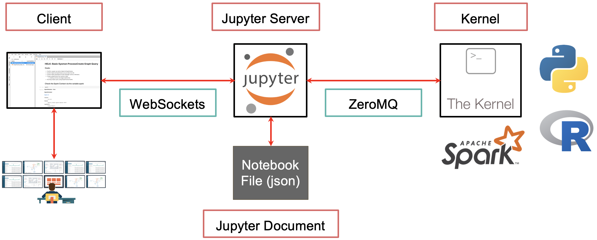
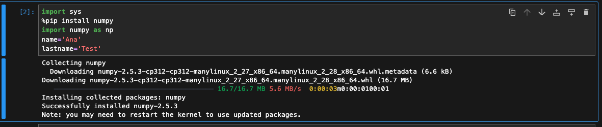

# What is a Jupyter Notebook?

Jupyter Notebook is an open-source web application that allows you to create and share documents that contain live code, equations, visualizations and narrative text. 

This is an interesting read: [The Infosec Community Definitive Guide to Jupyter Notebooks](https://infosecjupyterbook.com/getting-started/architecture.html)



There is also Kris Jenkins' episode in Developer Voices channel: [](https://www.youtube.com/watch?v=_-zhMzwpSOQ)


## Origin of the Name

Jupyter came from the IPython project. When they started working on language-agnostic features, they wanted to remove "Python" from the name. They named it after the three biggest languages they were targeting at the time: **Ju**lia, **Pyt**hon, and **R** → **Ju-Pyt-R**.

## Jupyter's Purpose and Users

Jupyter is the frontend to analytical tools in the ecosystem and a way of sharing exploratory analysis. It's used for:
- Sending notebook files
- Generating dashboards with low code
- Providing a REPL interface with richer output
- Education
- Exploratory coding
- Multiple programming languages

**Key user demographic**: People who write code but aren't software developers—scientists, educators, mathematicians, physicists. They write scientific code, not applications for the general public. Jupyter lowers the overhead so they can jump straight into what they're good at.

The project was named in 2014 when it wasn't clear which analytical language would dominate. While Python became the largest community, Jupyter remains committed to its language-agnostic architecture.

## Jupyter for Communication

Jupyter Notebooks serve as a communication medium. You can send them by email or deploy via Binder.

**Prime example**: LIGO project used Jupyter Notebooks to publish all data processing and signal processing work related to detecting gravitational waves. This allowed others to:
- Run the analysis
- See exactly what was done
- Tweak and verify results

Instead of sharing static PDFs or CSVs, sharing the actual notebook means analysis and its answers are in the same place. Jupyter natively understands LaTeX snippets inside cells for equations.

## Adoption in Finance

Jupyter is very popular in financial institutions—banks and funds. Often as many people have Jupyter open as have spreadsheet software. Users typically have backgrounds in mathematics, finance, or physics, not necessarily software engineering.

Hedge funds support Jupyter because quantitative analysts use it to drive buying/selling decisions. Finance firms recruit people already trained on these tools.

## Jupyter Architecture: How It Works

When you hit Shift+Enter to run a cell:
1. A message is sent to the backend server
2. The kernel executes your code
3. A message is sent back to the frontend for display

This follows a well-defined, language-agnostic protocol. The frontend doesn't know what language the kernel is executing.

### Communication Protocol

- The protocol uses **ZeroMQ** (open-source)
- Provides a language-agnostic way to communicate with a process
- Fast and allows servers/kernels in any language
- Both sides just need to agree on the messaging protocol

**WebSocket connection**: The frontend communicates with the Jupyter backend over WebSockets, which then talks to the kernel via ZeroMQ channels.

### Kernel Architecture

- 60+ language kernels available
- The kernel is responsible for executing code
- It's completely agnostic to the frontend (notebook, console, etc.)
- Kernels follow the same lifecycle, mediated by a server

## Building a New Kernel

To implement a new language kernel, you need to:
1. Implement multiple message types
2. Handle message signing
3. Implement concurrency requirements
4. Process messages while code is running

**Xeus project**: A C++ implementation of the protocol that helps create kernels. You override a few language-specific methods. Most kernels embed the language interpreter (Python, R) in a C++ process.

### Message Types

- **Control messages**: Kernel lifecycle (shut down, restart) and debug messages
- **Execution requests**: Main channel for running code
- **Inspect requests**: Getting docstrings and class information

The kernel must be multi-threaded or have concurrency to:
- Process control messages while code runs
- Handle stop/interrupt messages

### LSP (Language Server Protocol)

LSP provides static analysis of the workspace:
- Inline warnings
- Auto-complete suggestions
- Treats code as text (doesn't execute it)

LSP and kernel complement each other:
- Kernel provides runtime information
- LSP provides static analysis
- Both can provide auto-complete suggestions

### LLM Integration

Jupyter AI allows LLM suggestions. LLMs are standalone services and not part of the kernel. There are proposals to expand the kernel protocol with a new channel for AI/machine clients.

## Security Concerns

The core feature of Jupyter is arbitrary code execution as a service. You cannot assume any limiting to code that will be run.

**Attack scenarios**:
- Cloud provider protecting itself from users
- Protecting users from each other (with sharing features)
- Collaborators in the same document

**Mitigations**:
- Cloud services treat user code as hostile by default
- Isolated Docker environments
- VMs (mybinder.org spins up a VM per user)
- WASM-based execution in the browser (no filesystem to destroy)
- Rich content display may run JavaScript—must be isolated

## Execution Model

- Jupyter is essentially "REPL as a service"
- One execution thread unless you create your own threads
- Control threads exist for debugging and monitoring

**Concurrent execution**: The notebook runs code sequentially. You can write threaded code or use libraries like Dask. There are projects that detect independent cells and run them in parallel, but this hasn't landed in core Jupyter and is language-specific.

**Reconnection**: Jupyter clients can reconnect to kernels after page refresh. If you close your laptop and come back, the connection re-establishes and streaming output continues. Long-running jobs (27+ hours) are still being worked on.

---

## Jupyter as an Application Framework (Beyond Notebooks)

### Evolution

Jupyter has evolved from:
1. IPython → improved Python wrapper
2. Kernel-client architecture → language agnostic
3. Notebook → became very popular
4. Jupyter Lab → more feature-full, closer to an IDE

### Jupyter Lab as a Framework

Jupyter Lab provides primitives that aren't specific to IDEs:
- Tiled window layout
- Theming and configurable keyboard shortcuts
- Internationalization
- Extensibility with plugins
- Dependency injection system
- Command palette
- File browser
- Status bar
- Drag-and-droppable tabs
- Menu system

**Goal**: Provide a rich application framework for desktop-like experiences in the browser, competing with tools like Qt for C++ desktop apps.

### Real-Time Collaboration

Jupyter provides RTC building blocks using **YJS** (CRDT library):
- Conflict-free Replicated Data Types
- Supports text, number arrays, matrices, booleans
- Can represent JSON-like documents
- History browser for tracking changes

**Challenges**:
- CRDTs don't handle schema constraints well (e.g., "notebook must have at least one cell")
- Constraints that bind data from different parts of the document are problematic
- Better to use flatter data formats than typical XML/JSON schemas

**Undo behavior** = "last thing I did" (per user), not "last thing that happened"

**Git integration**: RTC history and Git history aren't unified yet. Separate plugins exist.

The episode continues but this is enough for this introduction.

# Infrastructure setup

I'll use Proxmox, there is a Jupyter Notebook Helper Script:

## Proxmox
https://community-scripts.org/scripts?q=jupyter&preview=jupyternotebook

The Proxmox VE Helper Script creates a complete, lightweight LXC container that acts as a server, and inside it, it installs a Jupyter Notebook server that runs a Python 3 kernel by default.

- Virtual Environment: Isolated Python at `/opt/jupyter/.venv` with its own Python 3.12.14
- No Activation: Script uses full paths (`/opt/jupyter/.venv/bin/python`) everywhere - never runs source activate
- System Python: Stays at 3.12.3, untouched by the installation
- Two Python Versions: System (3.12.3) vs Venv (3.12.14) - they don't conflict
- Systemd Service: Runs Jupyter at boot on port 8888 with auto-restart
- Idempotent Script: Safe to run multiple times - installs if missing, updates if present

The script has 4 phases:
- Setup → Defines container resources (2 CPU, 2GB RAM, 4GB disk)
- Install/Update → If Jupyter missing, create venv and install; if present, update
- Service → Creates systemd service using full path to Jupyter binary
- Complete → Shows access URL: http://[IP]:8888

### Steps
In the Proxmox host: 
- Create container: `bash -c "$(wget -qLO - https://...)"`
- Enter container	`pct enter <id>`

Inside the container: 
- Get Jupyter token `jupyter notebook list`
- If needed:
  - Check service status `systemctl status jupyternotebook`
  - Restart Jupyter	`systemctl restart jupyternotebook`

Different python versions:
```
root@jupyternotebook:~# python3 --version
Python 3.12.3
root@jupyternotebook:~# /opt/jupyter/.venv/bin/python --version
Python 3.12.14
```

A kernel identifies itself to IPython by creating a directory, the name of which is used as an identifier for the kernel.

```
root@jupyternotebook:/opt/jupyter/.venv/share/jupyter/kernels# ls
python3
````

There's a python kernel already present:

```
root@jupyternotebook:/opt/jupyter/.venv/share/jupyter/kernels/python3# ls
kernel.json  logo-32x32.png  logo-64x64.png  logo-svg.svg
root@jupyternotebook:/opt/jupyter/.venv/share/jupyter/kernels/python3# cat kernel.json
{
 "argv": [
  "python",
  "-m",
  "ipykernel_launcher",
  "-f",
  "{connection_file}"
 ],
 "display_name": "Python 3 (ipykernel)",
 "language": "python",
 "metadata": {
  "debugger": true,
  "supported_encryption": "curve"
 },
 "kernel_protocol_version": "5.5"
}
```
After:

Open a browser
Go to http://192.168.1.138:8888
When prompted, paste the token from `jupyter notebook list`

Create Your First Notebook
New button (top right) → Select Python 3 (ipykernel)

### Notes:

The import Statement: It Only Finds, Doesn't Install
`import sys` 

When you run import numpy as np, Python is simply telling the system: "Find a module named 'numpy' and make it available." It will look in specific directories (like your virtual environment's site-packages folder) for an already-installed numpy package. If it can't find it, it will immediately raise a `ModuleNotFoundError` and stop execution.

It does not trigger a pip install behind the scenes. In the Jupyter environment, import and pip install are two entirely separate steps



#### PEP 621

https://packaging.python.org/en/latest/specifications/pyproject-toml/#pyproject-toml-spec

https://peps.python.org/pep-0621/
https://packaging.python.org/en/latest/guides/writing-pyproject-toml/#writing-pyproject-toml

`pyproject.toml`
This is the modern standard defined in PEP 621. It's like Python's version of package.json (Node.js) 

`uv` is both a virtual environment manager and a package manager

`%pip` Is Special in Jupyter
The %pip magic command is smart because it:
- Knows which Python kernel you're using (the venv one at /opt/jupyter/.venv/bin/python3)
- Ensures packages go into that kernel's site-packages (/opt/jupyter/.venv/lib/python3.12/site-packages/)
- Works even if the venv isn't "activated" in your shell

Since the server uses `uv`, can also install packages with uv from a notebook cell:
`! /opt/jupyter/.venv/bin/uv pip install numpy`

this is more verbose and less reliable than %pip. The %pip magic is specifically designed for Jupyter notebooks and is the recommended approach.

`!` in Jupyter: The Shell Escape
The exclamation mark ! in Jupyter is a shell escape - it tells Jupyter to run whatever follows as a shell command

- Use `%`pip for installing packages in Jupyter.
- Use `!` for everything else (file operations, system commands)

Cell magics
```
%%bash - Run Bash/Shell Commands
python
%%bash
echo "I'm running in bash!"
ls -la /opt/jupyter/
whoami
ps aux | grep jupyter
```

```
/opt/jupyter/
├── First-notebook.ipynb          # Your notebook file
└── .venv/                        # The virtual environment
    ├── bin/                      # Executables (python, pip, jupyter)
    ├── lib/                      # Python packages (site-packages/)
    ├── lib64/                    # Symlink to lib/ (for compatibility)
    ├── etc/                      # Configuration files
    ├── share/                    # Shared data (Jupyter kernels, etc.)
    │   └── jupyter/
    │       ├── kernels/          # Kernel specifications
    │       │   └── python3/
    │       │       └── kernel.json
    │       ├── lab/              # JupyterLab extensions
    │       ├── labextensions/    # More Lab extensions
    │       ├── nbconvert/        # Notebook conversion templates
    │       └── nbextensions/     # Classic notebook extensions
    ├── CACHEDIR.TAG              # Cache directory marker
    └── pyvenv.cfg                # Venv configuration (Python version, etc.)
```

`.ipynb file extensions`

Jupyter `checkpoints` are like simple, local "save points," but they are definitely not the same as a full version control system like Git.
Think of a checkpoint as a quick undo button for your notebook's content and state, whereas Git is a complete time machine for your entire project history.